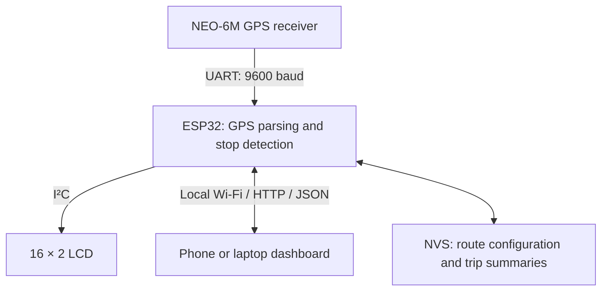

# 🚌 BUSLYTICS — Smart Bus Tracking & Arrival Prediction System

**Real-time GPS monitoring · Approximate arrival predictions · Local web dashboard**

A self-contained educational prototype built with an ESP32, NEO-6M GPS module, 16×2 I²C LCD and a responsive browser dashboard.

## 📖 Overview

BUSLYTICS is an ESP32-based bus tracking and arrival prediction project that displays live GPS information and estimated arrival times through a locally hosted web dashboard. The system reads position and speed data from a NEO-6M GPS receiver, processes it on the ESP32, and makes telemetry available to a phone or laptop connected to the same Wi-Fi network.

In addition to real GPS tracking, BUSLYTICS includes route and bus-stop management, an interactive map, a separately labeled virtual bus simulator, device diagnostics and on-device trip-history storage. A 16×2 I²C LCD displays the dashboard IP address at startup and cycles through information pages after the dashboard is opened.
Scope: This is a local-network, single-bus prototype. The published implementation does not contain Firebase/cloud synchronization, a cellular modem, remote internet tracking, live traffic integration or AI/ML-based prediction. Real GPS and simulated positions are intentionally distinguished.

## 📸 System Image


## 🎥 Demonstration Video

[▶ Watch the BUSLYTICS demonstration on YouTube](https://youtu.be/XVsEAV2rr50)

## ✨ Features

| Module | Capabilities |
| --- | --- |
| Live GPS Tracking | Latitude, longitude, speed, satellite count, heading, GPS fix age and HDOP |
| Interactive Dashboard | Responsive interface for mobile and desktop browsers; updates GPS telemetry approximately every 2.5 seconds |
| Bus Stops & ETA | Configurable bus route with up to 12 stops, approximate distance and ETA for upcoming stops |
| Automatic Stop Advancement | Advances the next-stop index after a fresh GPS fix remains within 80 m of a stop for 8 seconds |
| Local Wi-Fi | ESP32 AP + STA operation: its own hotspot and optional connection to an existing Wi-Fi network |
| LCD Interface | Startup IP screen followed by 8 rotating information pages (about every 3.5 seconds) |
| Virtual Bus Simulator | Animated journeys with adjustable speed, playback controls and online road-route geometry when available |
| Trip History | Saves up to 30 recent trip summaries for manually recorded real-GPS journeys and authenticated simulator sessions |
| Persistent Configuration | Stores route details and trip summaries using separate ESP32 Preferences/NVS namespaces |
| Device Health | Shows GPS status, Wi-Fi state, IP address, RSSI, uptime and free heap memory |
| Admin Controls | Password-controlled route changes, trip-history actions and optional simulation-to-LCD mirroring |

## 🧩 System Architecture

The ESP32 runs the web server and returns JSON telemetry directly to the browser. No separate HTML file, Firebase project or application server is required at runtime: the complete dashboard is embedded in the Arduino sketch.



## 🔌 Hardware Requirements

| Component | Quantity | Function |
| --- | --- | --- |
| ESP32 DevKit V1 | 1 | Main microcontroller and Wi-Fi web server |
| NEO-6M GPS module with antenna | 1 | Satellite-based position and speed reception |
| 16×2 LCD with I²C backpack | 1 | Local status, dashboard IP and ETA display |
| USB data cable | 1 | Firmware upload and power |
| Compatible 5V USB supply / power bank | 1 | Powers the ESP32 |
| Jumper wires and mounting accessories | As needed | Hardware connections and assembly |

### Verified GPIO Connections

The following GPIO labels come directly from the completed Arduino sketch. Use the silkscreen labels on your specific ESP32 board rather than assuming physical header-pin numbers, which differ between 30-pin and 38-pin variants.

| Module | Module pin | ESP32 connection | Notes |
| --- | --- | --- | --- |
| NEO-6M GPS | TX | GPIO16 (RX2) | GPS → ESP32 serial data |
|  | RX | Not connected | Not needed for receive-only GPS operation |
|  | VCC | Module-rated power supply | Some GPS breakout boards accept 5V; confirm your module |
|  | GND | GND | Shared ground |
| 16×2 I²C LCD | SDA | GPIO21 | I²C data |
|  | SCL | GPIO22 | I²C clock |
|  | VCC | LCD-rated supply | Commonly 5V for LCD backpacks |
|  | GND | GND | Shared ground |

Code settings: GPS_RX_PIN = 16, GPS_TX_PIN = 17, LCD_SDA_PIN = 21, LCD_SCL_PIN = 22, LCD_ADDRESS = 0x27. Although UART2 TX is initialized on GPIO17, it does not need to be physically connected when the GPS module's RX is unused.

Electrical safety: This prototype was assembled without an I²C level shifter. Nevertheless, the ESP32's GPIO pins are not 5V tolerant. Some 5V LCD backpacks pull SDA/SCL up to 5V. Verify those signal levels and add an appropriate level shifter or compatible pull-up arrangement if necessary. Use the GPS board's specified supply voltage and connect all grounds together.

## 🛠️ Software & Libraries

Development environment: Arduino IDE, with the ESP32 by Espressif Systems board package installed through Boards Manager.

Install these libraries using Sketch → Include Library → Manage Libraries:

| Library | Used for |
| --- | --- |
| TinyGPSPlus — Mikal Hart | Parsing NMEA sentences received from the GPS module |
| LiquidCrystal_I2C — compatible init() / backlight() variant | Operating the 16×2 I²C LCD |
| ArduinoJson 7.x — Benoit Blanchon | JSON configuration, API responses and trip records |

The ESP32 board package provides WiFi.h, WebServer.h, Preferences.h and Wire.h. The embedded dashboard uses HTML, CSS, JavaScript and Leaflet.js; OpenStreetMap tiles and the optional online road-routing service are loaded by the browser when internet connectivity is available.

## 🚀 Getting Started

### 1. Assemble the circuit

Wire the GPS and LCD exactly as shown in the connection table. Connect the ESP32 to your computer with a USB data cable.
### 2. Install the ESP32 board package and libraries

Open Arduino IDE, install ESP32 by Espressif Systems, then install TinyGPSPlus, a compatible LiquidCrystal_I2C library and ArduinoJson 7.x.
### 3. Open the firmware

Open firmware/BUSLYTICS/BUSLYTICS.ino in Arduino IDE and select your actual ESP32 board and serial port. The sketch is one file and includes the web dashboard HTML internally.
### 4. Configure Wi-Fi and administrator credentials

Near the start of the sketch, change the following placeholder settings before flashing:
```cpp
const char* WIFI_SSID       = "YOUR_WIFI_SSID";
const char* WIFI_PASSWORD   = "YOUR_WIFI_PASSWORD";
const char* AP_SSID         = "BUSLYTICS-ESP32";
const char* AP_PASSWORD     = "CHANGE_THIS_AP_PASSWORD";
const char* ADMIN_PASSWORD  = "CHANGE_THIS_ADMIN_PASSWORD";
```

- WIFI_SSID / WIFI_PASSWORD: optional router or mobile-hotspot connection credentials.
- AP_SSID / AP_PASSWORD: credentials for the ESP32's fallback access point; use a strong password of at least 8 characters.
- ADMIN_PASSWORD: separate, strong password for protected dashboard changes and trip-history operations.
Do not commit your real Wi-Fi or administrator passwords to a public GitHub repository. The supplied public copy of the firmware uses placeholders; configure your own local copy before upload to the ESP32. If credentials were committed previously, rotate them and remove them from the repository history.
### 5. Upload and open Serial Monitor

Compile and upload the sketch, then set Serial Monitor to 115200 baud. The GPS UART itself runs at 9600 baud and is handled separately by the firmware.
### 6. Open the dashboard

The ESP32 creates a local hotspot and also attempts to join the configured Wi-Fi network.

### Option A — Connect directly to ESP32

1. Connect your phone/laptop to the configured ESP32 access-point SSID.
2. Open [http://192.168.4.1](http://192.168.4.1) in a browser.

### Option B — Use an existing Wi-Fi network

1. Connect your phone/laptop to the same network as the ESP32.
2. Read the station IP address on the LCD or Serial Monitor.
3. Open `http://<ESP32_STATION_IP>` in your browser.
The LCD initially displays the IP address and continues showing it until a browser opens the dashboard. After that, it rotates through eight pages showing network information, real GPS or clearly labeled simulated values, bus/route details, next-stop ETA and device status.
### 7. Obtain a GPS fix and configure a route

For initial testing, place the GPS antenna where it has a clear view of the sky. Wait for a valid GPS fix, then open Route Setup in the dashboard. Enter the bus ID, route name, ordered stop names and coordinates, fallback speed and administrator password. Save the settings; they persist in ESP32 NVS after a normal restart.

## 🗺️ Arrival-Time Prediction

BUSLYTICS estimates arrival time using the bus's position, the configured stop coordinates and a recent GPS speed average.

```text
Approximate ETA (minutes) = Remaining distance (km) / Speed (km/h) × 60
```

In real GPS mode, the dashboard uses straight-line (Haversine) distances between coordinates, not the actual driving-road distance. GPS speed values are sampled about every 2 seconds and averaged over up to 10 recent samples. If the average is below 2 km/h, the prediction uses the configured fallback speed (default 25 km/h).

For example, if the estimated distance is 5 km and the chosen speed is 30 km/h, the ETA is approximately 10 minutes.

Prediction limitations: The estimate can differ from actual arrival time because of road geometry, traffic, bus stops, signal delays, GPS errors and the fallback-speed behavior. It is not a live-traffic-aware prediction model.

### Automatic Stop Detection

The firmware moves to the next configured stop after a fresh GPS position stays within 80 metres of the current stop for 8 consecutive seconds. The next-stop index is saved in flash. To start a new trip after the final stop, reset the index from Route Setup.

## 🧪 Virtual Bus Simulator

The dashboard provides a separate demonstration mode for showing how a bus moves between configured stops without physically moving the GPS device.
1. Save at least two bus stops in Route Setup.
2. Open Bus Simulator and select Load Route & Enable Simulation.
3. Choose a simulated speed (10–100 km/h) and playback multiplier (1×, 10×, 30×, 60× or 120×).
4. Select Start to animate the virtual bus and observe simulated ETAs.
5. Optionally enter the admin password to mirror SIM-labeled values on the LCD.
6. Use Return to Real GPS to restore the normal dashboard view.
When internet access is available, the simulator may use the online OSRM routing service to fetch road geometry. Otherwise it falls back to direct stop-to-stop segments and can display an offline schematic instead of a road map. Simulation does not modify or masquerade as the physical receiver's GPS readings.

## 💾 Trip History & Local Storage

BUSLYTICS stores a rotating set of up to 30 trip summaries in ESP32 nonvolatile flash memory. It uses separate smartbus and bustrips storage namespaces for route data and trip history.
- Real GPS trips: Start and finish a recording from Trip History with a valid GPS fix and the administrator password.
- Simulated trips: Can be recorded and saved as SIM sessions when authorized through the dashboard.
- Stored summary fields: Trip type, route, bus ID, start/end times, duration, distance and average/maximum speeds.
- History controls: View recent summaries, delete a record or clear the history without deleting saved route settings.
The device does not store a complete permanent GPS-coordinate trace for every journey. Real trip recording filters small GPS movements and unrealistic jumps, so logged distances are approximate. An unfinished recording may be lost if power is interrupted.

## 🧭 Dashboard Modules

| Page | What you can do |
| --- | --- |
| Overview | View headline metrics, current position, next-stop ETA, route stops and recent speed telemetry |
| Live Tracking | Explore the map and current location; view the position trail while the page is open |
| Bus Simulator | Demonstrate virtual bus travel and approximate arrival predictions |
| Stops & ETA | Inspect the sequence of upcoming stops and estimated arrival times |
| Device Health | Check physical GPS, satellites, Wi-Fi connectivity, uptime and heap memory |
| Trip History | View and manage recorded real/simulated trip summaries |
| Route Setup | Configure bus identity, stops, fallback speed and next-stop index |

## 🔗 HTTP API Reference

The ESP32 serves its dashboard over port 80. Public read endpoints and password-protected write endpoints are implemented in the sketch.

| Method | Endpoint | Purpose | Admin password required? |
| --- | --- | --- | --- |
| GET | / | Embedded web dashboard | No |
| GET | /api/live | Real GPS and controller telemetry | No |
| GET | /api/config | Route and bus configuration | No |
| POST | /api/config | Save route and stop settings | Yes |
| POST | /api/lcd-sim | Optional simulated LCD display | Yes |
| GET | /api/trips | Recent trip summaries | No |
| POST | /api/trips/start-gps | Start a real GPS trip | Yes |
| POST | /api/trips/stop-gps | Finish and save a GPS trip | Yes |
| POST | /api/trips/record | Save an authenticated SIM trip summary | Yes |
| POST | /api/trips/delete | Delete one trip summary | Yes |
| POST | /api/trips/clear | Clear trip-history records | Yes |

Protected operations use an X-Admin-Key request header. Security warning: HTTP traffic is not encrypted, and read endpoints expose location information to users with network access. Use BUSLYTICS on a trusted local network, not directly on the public internet.

## 📂 Repository Structure

| Path | Purpose |
| --- | --- |
| `README.md` | Project documentation |
| `firmware/BUSLYTICS/BUSLYTICS.ino` | Single-file ESP32 sketch with embedded dashboard |
| `docs/images/architecture.png` | System architecture |
| `docs/images/wiring.png` | Connection reference |
| `docs/images/flowchart.png` | Firmware operation flow |
| `docs/images/dashboard-demo.png` | Illustrative dashboard preview |

## 🩺 Troubleshooting

| Problem | What to check |
| --- | --- |
| GPS searching / no fix | Move antenna outdoors or near a clear window; verify the module supply, GPS TX → GPIO16 and common GND. |
| No text on LCD | Check I²C address 0x27, SDA → GPIO21, SCL → GPIO22, LCD contrast, power rating and library compatibility. |
| Dashboard does not open | Connect to ESP32 AP or the same router network; use the correct IP shown on LCD/Serial Monitor. |
| Map background missing | Leaflet/OSM map tiles need internet; the locally hosted telemetry/ETA functions can still work. |
| ETA displays -- | Wait for a valid GPS fix and configure at least one upcoming bus stop. |
| ETA seems inaccurate | Verify stop order/coordinates; remember that real mode uses straight-line distances and fallback speed. |
| Route will not save | Enter the correct administrator password and check stop coordinates and the 12-stop limit. |
| Simulation cannot load road route | Check browser internet access; the direct-line fallback may still operate. |
| Trip cannot start | Wait for a fresh GPS fix and enter the administrator password. |
| Trip not saved | Confirm admin authorization and available flash/NVS storage; complete the trip before powering off. |

## 🚧 Known Limitations & Future Scope

Current limitations: one tracked bus per ESP32, local Wi-Fi access only, approximate straight-line real-GPS ETA, remote map/routing assets requiring internet, a maximum of 12 configured stops and 30 stored trip summaries, and unencrypted HTTP with locally configured credentials.

Potential future enhancements:
- 4G/LTE communication and cloud synchronization for remote passenger access.
- Multi-bus fleet monitoring and separate passenger/admin roles.
- Road-distance and live-traffic-aware ETA models.
- HTTPS, stronger authentication and safer credential provisioning.
- Offline map-tile support and persistent full-trip GPS routes.
- Push notifications, bus-stop geofencing improvements and route-based alerts.

## 🎓 Applications

College and school bus demonstrations, embedded systems and IoT education, GPS telemetry prototypes, fleet-monitoring research, and smart-transportation proof-of-concept development.

## Author

**Eshwar Prasad Y**

Electronics & Communication Engineering

Embedded Systems | IoT | Automotive Electronics | Arduino | Microcontrollers

Email: [eshwargowda313@gmail.com](mailto:eshwargowda313@gmail.com)

LinkedIn: [Eshwar Prasad Y](https://www.linkedin.com/in/eshwar-prasad-y-a3043b370/)

## 🙏 Acknowledgements

This project makes use of open-source and publicly documented technologies including Arduino, Espressif ESP32, TinyGPSPlus, ArduinoJson, Leaflet and OpenStreetMap. Online road routing, when available, is requested from OSRM. Credits and usage requirements for these third-party projects remain with their respective authors and maintainers.

## 📄 License

No software license has been selected for this repository. Add a LICENSE file if you want to grant others explicit permission to reuse, modify or redistribute your source code.

---

**BUSLYTICS — Smart Bus Tracking & Arrival Prediction System**

Built to demonstrate practical GPS, embedded systems and local web technologies.
